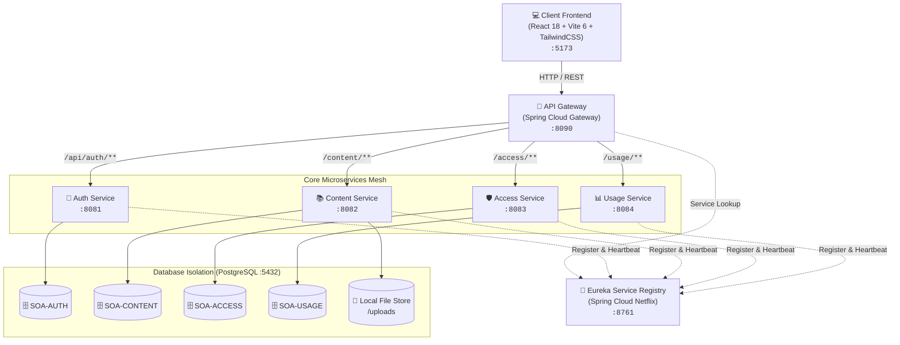
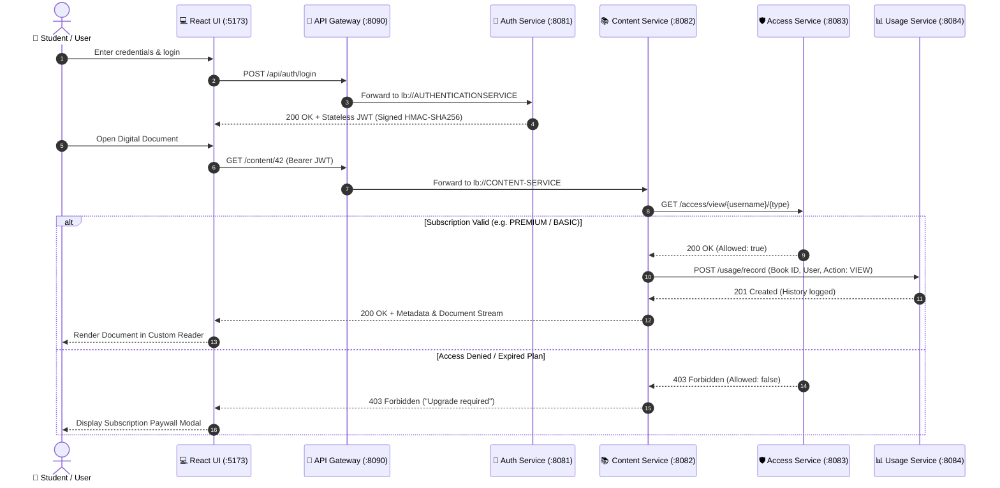

# 📚 ScholarSphere Digital
> **Next-Generation Distributed Academic Publishing & Content Rights Management Platform**  
> *Course Project | PS029: Digital Knowledge Platform & Content Access Management System*

<div align="center">


</div>

---

## 📖 Table of Contents
- [Executive Overview](#-executive-overview)
- [System Architecture & Data Flow](#-system-architecture--data-flow)
- [Microservices Mesh & Status Matrix](#-microservices-mesh--status-matrix)
- [Core Platform Capabilities](#-core-platform-capabilities)
- [API Gateway & Routing](#-api-gateway--routing)
- [Complete API Reference](#-complete-api-reference)
- [Tech Stack Breakdown](#-tech-stack-breakdown)
- [Prerequisites & Database Setup](#-prerequisites--database-setup)
- [Quick Start: Step-by-Step Execution](#-quick-start-step-by-step-execution)
- [Repository Structure](#-repository-structure)
- [Design Thinking & Research Artifacts](#-design-thinking--research-artifacts)
- [SOA Principles & Viva Cheat Sheet](#-soa-principles--viva-cheat-sheet)

---

## 💡 Executive Overview

**ScholarSphere Digital** is a distributed, service-oriented publishing and access control platform designed to deliver academic textbooks, peer-reviewed journals, and technical research documents to subscription-based institutions and students. 

Engineered under the **Service-Oriented Architecture (SOA)** paradigm, the system completely isolates authentication, digital content repository management, dynamic subscription entitlements (DRM), and user reading telemetry into independent, loosely coupled microservices. All client traffic is securely proxied through a unified **Spring Cloud API Gateway** with **Netflix Eureka** dynamic service discovery and stateless **JWT (JSON Web Token)** role-based security.

---

## 🏛️ System Architecture & Data Flow

### High-Level Topology



### Complete End-to-End Reading Flow



---

## ⚡ Microservices Mesh & Status Matrix

| Component | Port | Spring App Name | Database | Status | Primary Responsibilities |
| :--- | :---: | :--- | :--- | :---: | :--- |
| **Eureka Server** | `8761` | `EurekaServer` | *None* | `✅ Active` | Dynamic registry, health heartbeats & lookup directory |
| **API Gateway** | `8090` | `APIGATEWAY` | *None* | `✅ Active` | Central ingress, Eureka load balancing, CORS & route filtering |
| **Auth Service** | `8081` | `AUTHENTICATIONSERVICE` | `SOA-AUTH` | `✅ Active` | BCrypt password hashing, registration, role management, JWT minting |
| **Content Service** | `8082` | `CONTENT-SERVICE` | `SOA-CONTENT` | `✅ Active` | Books, journals & research metadata CRUD + multipart storage (`uploads/`) |
| **Access Service** | `8083` | `ACCESS-SERVICE` | `SOA-ACCESS` | `✅ Active` | DRM subscription tier management (`FREE`, `BASIC`, `PREMIUM`), entitlement checks |
| **Usage Service** | `8084` | `USAGE-SERVICE` | `SOA-USAGE` | `✅ Active` | Engagement logs, reading session telemetry, book popularity metrics |
| **Frontend Web App** | `5173` | `scholarsphere-frontend` | *None* | `✅ Active` | Modern portal, catalog reader, student & admin dashboards |

---

## ✨ Core Platform Capabilities

### 🎓 1. Student / Reader Experience
- **Cinematic Landing Page**: Responsive visual hero showcasing platform features and knowledge catalog.
- **Dynamic Digital Catalog**: Filterable repository of Books, Academic Journals, and Technical Research Papers.
- **Embedded Document Reader**: Fullscreen immersive reader supporting book navigation and citation info.
- **Self-Service Subscriptions**: Dynamic tier selection (`FREE`, `BASIC`, `PREMIUM`) with instant rights activation.
- **Personal Reading Telemetry**: Comprehensive reading history, access frequency stats, and favorite genres.

### 🛡️ 2. Administrative Suite
- **Central Management Console**: High-level platform health, total documents cataloged, and active subscriber metrics.
- **Content Publisher**: Multipart file uploader with category tags, author metadata, and local file persistence.
- **Access & DRM Rights Control**: Granular permission adjustments across subscription tiers (e.g., view vs. download permissions per content type).
- **Usage & Engagement Analytics**: Visual analytics tracking top-accessed documents, hourly reading surges, and user engagement.

---

## 🌐 API Gateway & Routing

All incoming client traffic targets **`http://localhost:8090`**. The gateway decouples clients from microservice hostnames and ports using Eureka dynamic load balancing (`lb://`):

| Ingress Route Pattern | Target Microservice URI | Purpose |
| :--- | :--- | :--- |
| `/api/auth/**` | `lb://AUTHENTICATIONSERVICE` | User signup, credential verification, and token exchange |
| `/content/**` | `lb://CONTENT-SERVICE` | Catalog browsing, metadata retrieval, document upload/deletion |
| `/access/**` | `lb://ACCESS-SERVICE` | Subscription tiers, active user plan checks, permission validation |
| `/usage/**` | `lb://USAGE-SERVICE` | Reading session logging, personal histories, access analytics |

*Note: The API Gateway automatically applies unified CORS handling (`http://localhost:5173`) and strips duplicate headers from downstream services.*

---

## 📑 Complete API Reference

### 🔐 1. Authentication Service (`/api/auth`)
| Method | Endpoint | Access | Description |
| :--- | :--- | :--- | :--- |
| `POST` | `/api/auth/register` | Public | Register new user with username, email, BCrypt password, and role |
| `POST` | `/api/auth/login` | Public | Validate credentials and return signed JWT token |

### 📚 2. Content Service (`/content`)
| Method | Endpoint | Access | Description |
| :--- | :--- | :--- | :--- |
| `GET` | `/content` | Public / Auth | List all published books, journals, and research documents |
| `GET` | `/content/{id}` | Auth | Retrieve content metadata and file path by ID |
| `POST` | `/content/upload` | Admin | Upload multipart file with JSON metadata payload |
| `DELETE` | `/content/{id}` | Admin | Delete content entry and purge physical file from storage |

### 🛡️ 3. Access & DRM Service (`/access`)
| Method | Endpoint | Access | Description |
| :--- | :--- | :--- | :--- |
| `GET` | `/access/subscription/{username}` | Auth | Fetch user's active subscription tier, start, and end date |
| `POST` | `/access/subscribe` | Auth | Subscribe user to `FREE`, `BASIC`, or `PREMIUM` tier for 30 days |
| `POST` | `/access/plans` | Admin | Create or update a subscription plan tier configuration |
| `GET` | `/access/view/{username}/{contentType}` | Service / Auth | Verify if user has entitlement to view document type |
| `GET` | `/access/download/{username}/{contentType}` | Service / Auth | Verify if user has entitlement to download document type |

### 📊 4. Usage Service (`/usage`)
| Method | Endpoint | Access | Description |
| :--- | :--- | :--- | :--- |
| `POST` | `/usage/record` | Auth | Log a reading or download action with duration & IP |
| `GET` | `/usage/history/my-history` | Auth | Fetch authenticated user's chronological reading history |
| `GET` | `/usage/history/user/{userId}` | Admin | Fetch reading history for a specific user ID |
| `GET` | `/usage/count/book/{bookId}` | Auth | Get total times the current user accessed a specific book |
| `GET` | `/usage/stats/book/{bookId}` | Auth / Admin | Retrieve total reads, unique readers, and total duration for a book |
| `GET` | `/usage/stats/my-stats` | Auth | Aggregated reading stats for current user (total books, hours read) |
| `GET` | `/usage/stats/most-accessed` | Auth / Admin | Fetch top $N$ most popular books across the entire platform |

---

## 💻 Tech Stack Breakdown

- **Backend Architecture**: Microservices / Service-Oriented Architecture (SOA)
- **Language**: Java 21 (LTS)
- **Framework**: Spring Boot 3.4.1
- **Service Discovery**: Spring Cloud Netflix Eureka Server
- **Routing & Proxy**: Spring Cloud Gateway 2024.0.0 (Reactive with LoadBalancer)
- **Security & Authorization**: Spring Security 6 + JJWT (Stateless HMAC-SHA256, 15-min expiration)
- **Persistence & ORM**: Spring Data JPA / Hibernate (DDL `update`)
- **Database Engine**: PostgreSQL 16 (Independent database per microservice)
- **Frontend Stack**: React 18, Vite 6, Tailwind CSS 3, Axios

---

## 🛠️ Prerequisites & Database Setup

### Prerequisites
1. **Java Development Kit (JDK)**: OpenJDK 21 installed (`java -version`).
2. **Apache Maven**: Version 3.9+ installed (`mvn -version`).
3. **Node.js & npm**: Node.js 18+ and npm 9+ (`node -v`, `npm -v`).
4. **PostgreSQL**: Running on port `5432`.

### 🗄️ PostgreSQL Database Setup
ScholarSphere isolates data across dedicated databases following microservice best practices. Execute the following SQL commands in PostgreSQL (`psql` or pgAdmin):

```sql
-- Create isolated microservice databases
CREATE DATABASE "SOA-AUTH";
CREATE DATABASE "SOA-CONTENT";
CREATE DATABASE "SOA-ACCESS";
CREATE DATABASE "SOA-USAGE";
```

*(Default credentials configured: user `postgres`, password `1619` on `localhost:5432`)*

---

## 🚀 Quick Start: Step-by-Step Execution

To ensure seamless discovery registration, launch the components in the following chronological sequence:

### 1️⃣ Step 1: Start Eureka Service Registry
```bash
cd Backend/EurekaServer
./mvnw spring-boot:run
```
*Wait until Eureka dashboard is live at 👉 **`http://localhost:8761`**.*

### 2️⃣ Step 2: Start the Core Microservices
Open separate terminal tabs for each service:

```bash
# Terminal 2: Authentication Service
cd Backend/AuthenticationService
./mvnw spring-boot:run

# Terminal 3: Content Service
cd Backend/ContentService
./mvnw spring-boot:run

# Terminal 4: Access Service
cd Backend/AccessService
./mvnw spring-boot:run

# Terminal 5: Usage Service
cd Backend/UsageService
./mvnw spring-boot:run
```
*Verify on Eureka (`http://localhost:8761`) that `AUTHENTICATIONSERVICE`, `CONTENT-SERVICE`, `ACCESS-SERVICE`, and `USAGE-SERVICE` appear with status **UP**.*

### 3️⃣ Step 3: Start Spring Cloud API Gateway
```bash
# Terminal 6: API Gateway
cd Backend/ApiGateway
./mvnw spring-boot:run
```
*Gateway will bind to port **`8090`**.*

### 4️⃣ Step 4: Start Frontend Client
```bash
# Terminal 7: React Frontend
cd frontend
npm install
npm run dev
```
*Open your browser and navigate to 👉 **`http://localhost:5173`**.*

---

## 📁 Repository Structure

```text
SOA-project/
├── Backend/
│   ├── EurekaServer/            # Netflix Eureka Service Discovery (Port 8761)
│   ├── ApiGateway/              # Spring Cloud Gateway (Port 8090)
│   ├── AuthenticationService/   # User accounts & JWT security (Port 8081)
│   ├── ContentService/          # Digital library catalog & file storage (Port 8082)
│   ├── AccessService/           # Subscription tiers & DRM verification (Port 8083)
│   └── UsageService/            # Reading logs & engagement analytics (Port 8084)
│
├── frontend/
│   ├── src/
│   │   ├── components/          # Reusable UI components (Navbar, ProtectedRoute)
│   │   ├── context/             # AuthContext & global state providers
│   │   ├── layouts/             # DashboardLayout & navigation chrome
│   │   ├── pages/               # Student & Admin pages (Books, Reader, Analytics, etc.)
│   │   └── services/            # Axios API clients & auth interceptors
│   ├── package.json
│   ├── tailwind.config.js
│   └── vite.config.js
│
├── Customer Journey Map.jpg     # UX Journey workflow artifact
├── Empathy Map.jpg              # User persona & empathy mapping artifact
├── Poster for ScholarSphere.jpg # High-resolution project poster
├── problem Statement.jpeg       # Formal PS029 problem specification
└── Architecture.rtf             # SOA design notes and specification
```

---

## 🎨 Design Thinking & Research Artifacts

The system was designed following human-centered Design Thinking methodologies:

| Artifact | File Reference | Description |
| :--- | :--- | :--- |
| 🖼️ **Project Poster** | [`Poster for ScholarSphere.jpg`](Poster%20for%20ScholarSphere.jpg) | Visual presentation poster highlighting core modules and impact |
| 🗺️ **Customer Journey Map** | [`Customer Journey Map.jpg`](Customer%20Journey%20Map.jpg) | End-to-end journey stages: Discovery $\rightarrow$ Auth $\rightarrow$ Subscription $\rightarrow$ Reading $\rightarrow$ Metrics |
| 🧠 **Empathy Map** | [`Empathy Map.jpg`](Empathy%20Map.jpg) | Persona pain points (paywalls, scattered catalogs, reading tracking) |
| 📑 **Problem Statement** | [`problem Statement.jpeg`](problem%20Statement.jpeg) | Formal specifications and deliverables for **PS029** |
| 📐 **Architecture Specs** | [`Architecture.rtf`](Architecture.rtf) | In-depth technical breakdown and service contract definitions |

---

## 💡 SOA Principles & Viva Cheat Sheet

When explaining ScholarSphere during practical evaluations or viva reviews, highlight these foundational architectural choices:

1. **Loose Coupling & High Cohesion**:
   - Each service focuses strictly on a single business domain (Single Responsibility Principle). Modifying the subscription billing rules in `AccessService` has zero impact on the document streaming code in `ContentService`.
2. **Database-per-Service Pattern**:
   - Instead of a monolithic shared database, each service connects to its own private PostgreSQL database (`SOA-AUTH`, `SOA-CONTENT`, etc.). This enforces data encapsulation and prevents hidden transactional coupling.
3. **Dynamic Discovery over Hardcoded Routing**:
   - Services do not hardcode IP addresses or port numbers. Instead, they register with **Netflix Eureka**. When the API Gateway routes `/usage/**`, it queries Eureka for healthy instances of `USAGE-SERVICE` dynamically.
4. **Stateless Scalability with JWT**:
   - Authentication generates cryptographically signed JWT tokens carrying user identity and roles (`USER` vs `ADMIN`). The backend services do not maintain server-side sessions, enabling horizontal scaling without sticky session overhead.
5. **Single Ingress Point (API Gateway Pattern)**:
   - Clients only ever need to talk to port `8090`. The Gateway encapsulates internal network complexity, standardizes CORS, and prevents exposing internal microservice ports to public networks.

---

<div align="center">

**Developed for Course Project — Service-Oriented Architecture (SOA)**  
*KL University | Digital Knowledge Platform & Content Access Management System (PS029)*

</div>
